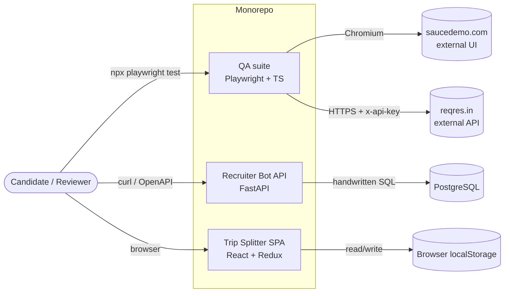
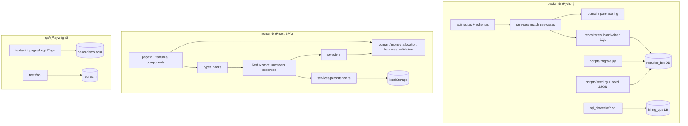

# High-Level Design (as built, 2026-10-28)

> This is a small assignment-scale monorepo with **three independent applications**. It is **not a distributed system**: no microservices, message bus, cache or cloud infrastructure. Each package runs on its own, and they share nothing at runtime.

## 1. System context

## 2. Containers and components

## 3. Runtime / deployment views

| Mode | Recruiter Bot | Trip Splitter | QA |
|---|---|---|---|
| **Host (primary)** | `docker compose up -d db` (or local Postgres) → venv → `python -m scripts.migrate` → `python -m scripts.seed` → `uvicorn app.main:app` | `npm install && npm run dev` | `npm install && npx playwright install chromium && npx playwright test` |
| **Compose (optional)** | `docker compose up` (db + api), then `docker compose run --rm api python -m scripts.migrate` / `scripts.seed` | n/a | n/a |

Details: `deployment.md`.

## 4. Main data flows

**4.1 Seed ingestion (Recruiter Bot)**
1. Load `seed/recruiter_bot_seed.json` and validate it (15 candidates, 6 jobs, field types).
2. Open one transaction.
3. Upsert the vocabulary (skills, tags).
4. Upsert candidates and jobs by explicit id.
5. Replace each entity's junction rows.
6. Assert the counts, then commit.

Re-running gives identical state.

**4.2 Match request**
1. `GET /jobs/{id}/matches` is received and the id is validated (int ≥ 1, else 422).
2. The service asks the repository for the job profile (missing → 404) and for all candidate profiles. This is 2 SQL queries with joins and `array_agg`.
3. `score_pair` runs for each candidate.
4. The results are sorted with the shared comparator and serialised to the response DTO.

The reverse direction is symmetric.

**4.3 Trip Splitter add expense**
1. The form holds a draft as strings.
2. On Save, `validateExpenseDraft(draft, members, today)` returns either `{ ok: true, expense }` or `{ ok: false, errors }`.
3. On errors, they are shown next to fields and focus moves to the first invalid field. Nothing is dispatched.
4. On ok:
   - `dispatch(expenseAdded(expense))`
   - the persistence subscriber writes to localStorage
   - `navigate('/', { state: { notice } })`
   - selectors recompute balances.

**4.4 Trip Splitter boot**
1. `loadExpenses(localStorage, members)` → validated `Expense[]`, or `null`.
2. If `null`, fall back to the validated sample.
3. That becomes the store's preloaded state.

**4.5 QA**
- UI: a fresh browser context per test → LoginPage → action → `expect`.
- API: a `request` context with the `x-api-key` header → call → assert status and body.

## 5. Trust boundaries and secrets

| Boundary | Untrusted input | Control |
|---|---|---|
| HTTP → Recruiter Bot | Path params | Pydantic/FastAPI typing (int ≥ 1). Parameterised SQL. Generic 500 body with no stack trace. |
| App → PostgreSQL | DB credentials | `DATABASE_URL` env only. `.env` git-ignored. `.env.example` has placeholders. Optional least-privilege role. |
| localStorage → SPA | Any string (user/extension tampering, old versions) | `JSON.parse` in try. Type-guard validator. Fallback to sample. |
| SPA form → store | User text | Strict parsers. Only validated `Expense` objects are dispatched. React escapes output. |
| QA → ReqRes | API key (secret) | `REQRES_API_KEY` env / git-ignored `qa/.env`. Never logged or hard-coded. Traces/reports are git-ignored because they may contain request headers. |
| QA → SauceDemo | Public demo credentials from the brief | These are published test accounts, not secrets, so they may live in test code. |

## 6. Non-goals

Auth, multi-user concurrency, pagination, caching, rate limiting, observability stacks, CI/CD, cloud hosting, persisted match tables, a Recruiter Bot UI.
