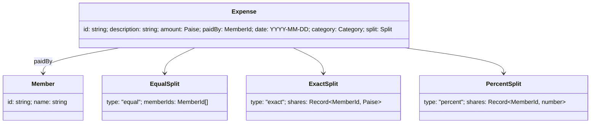

# Data Model (as built, 2026-10-28)

## 1. Recruiter Bot — normalised schema (PostgreSQL)

```mermaid
erDiagram
  candidates ||--o{ candidate_skills : has
  skills     ||--o{ candidate_skills : "used by"
  jobs       ||--o{ job_required_skills : requires
  skills     ||--o{ job_required_skills : "required by"
  candidates ||--o{ candidate_traits : has
  tags       ||--o{ candidate_traits : "used by"
  jobs       ||--o{ job_culture_keywords : has
  tags       ||--o{ job_culture_keywords : "used by"

  candidates { int id PK; text name UK; int years_experience; text availability; text quirk }
  jobs       { int id PK; text title UK; int min_experience; text tagline }
  skills     { int id PK; text name UK }
  tags       { int id PK; text name UK }
  candidate_skills     { int candidate_id PK,FK; int skill_id PK,FK; smallint position }
  job_required_skills  { int job_id PK,FK; int skill_id PK,FK; smallint position }
  candidate_traits     { int candidate_id PK,FK; int tag_id PK,FK; smallint position }
  job_culture_keywords { int job_id PK,FK; int tag_id PK,FK; smallint position }
```

### Draft DDL (`migrations/001_recruiter_bot_schema.sql`)

```sql
CREATE TABLE candidates (
    id               INTEGER PRIMARY KEY,                 -- explicit, source order 1..15
    name             TEXT    NOT NULL UNIQUE,
    years_experience INTEGER NOT NULL CHECK (years_experience >= 0),
    availability     TEXT    NOT NULL CHECK (availability IN ('Immediate', '2 weeks', 'Not looking')),
    quirk            TEXT    NOT NULL
);

CREATE TABLE jobs (
    id             INTEGER PRIMARY KEY,                   -- explicit, source order 1..6
    title          TEXT    NOT NULL UNIQUE,
    min_experience INTEGER NOT NULL CHECK (min_experience >= 0),
    tagline        TEXT    NOT NULL
);

CREATE TABLE skills (
    id   INTEGER GENERATED ALWAYS AS IDENTITY PRIMARY KEY,
    name TEXT NOT NULL UNIQUE CHECK (name <> '' AND name = lower(btrim(name)))
);

CREATE TABLE tags (            -- shared vocabulary for candidate traits and job culture keywords
    id   INTEGER GENERATED ALWAYS AS IDENTITY PRIMARY KEY,
    name TEXT NOT NULL UNIQUE CHECK (name <> '' AND name = lower(btrim(name)))
);

CREATE TABLE candidate_skills (
    candidate_id INTEGER  NOT NULL REFERENCES candidates (id) ON DELETE CASCADE,
    skill_id     INTEGER  NOT NULL REFERENCES skills (id),
    position     SMALLINT NOT NULL CHECK (position >= 1),
    PRIMARY KEY (candidate_id, skill_id),
    UNIQUE (candidate_id, position)
);
CREATE INDEX candidate_skills_skill_id_idx ON candidate_skills (skill_id);

-- job_required_skills, candidate_traits, job_culture_keywords: same pattern + FK-side index
```

### Design notes

- **Why junction tables, not `TEXT[]` columns:** a skill vocabulary gives referential integrity and allows "who has skill X" joins. It is also the textbook normalised design to defend. *Alternative:* Postgres arrays are simpler and well supported, but they are harder to constrain and less portable. Rejected.
- **Shared `tags` table:** traits and culture keywords are compared with each other, so one vocabulary makes the overlap a plain id equality. Separate tables would duplicate rows such as `decisive`.
- **`position`:** keeps the source display order without relying on insertion order.
- **Availability as a CHECK constraint:** a closed set of 3 source values. A lookup table would add a join for no benefit. Values keep the source spelling and capitalisation.
- **Normalisation:** stored names must already be trimmed lower-case. The source data satisfies this, so source labels are kept unchanged. If future data had mixed case, we would add a `display_name` column rather than alter the key.
- **Explicit ids** on candidates and jobs (not identity columns) keep URLs stable across reseeds.
- **No `matches` table:** a match is computed (ADR-003).
- **Indexes:** PK indexes cover lookups by entity. The extra FK-side indexes serve reverse lookups. These are trivial at this size and included for correctness of intent.
- `schema_migrations (version TEXT PRIMARY KEY, applied_at TIMESTAMPTZ NOT NULL DEFAULT now())` belongs to the runner.

## 2. SQL Detective — supplied schema, **unchanged**

These are the four tables exactly as given (PDF pp. 11–12), loaded into a separate database, `hiring_ops`. No keys or constraints are added beyond those in the source.

```mermaid
erDiagram
  recruiters   ||--o{ job_postings : "recruiter_id (logical, no FK)"
  job_postings ||--o{ interviews   : "job_posting_id (logical)"
  applicants   ||--o{ interviews   : "applicant_id (logical)"
  recruiters   { int id PK; varchar name; varchar region }
  job_postings { int id PK; varchar title; int recruiter_id; varchar department; date opened_date; varchar status }
  applicants   { int id PK; varchar full_name; varchar email; varchar source; date applied_date }
  interviews   { int id PK; int applicant_id; int job_posting_id; varchar stage; date scheduled_date; varchar outcome }
```

## 3. Trip Splitter — client-side model



localStorage key `trip-splitter:v1` → `{ "version": 1, "expenses": Expense[] }`. Members are not persisted (ADR-005).
